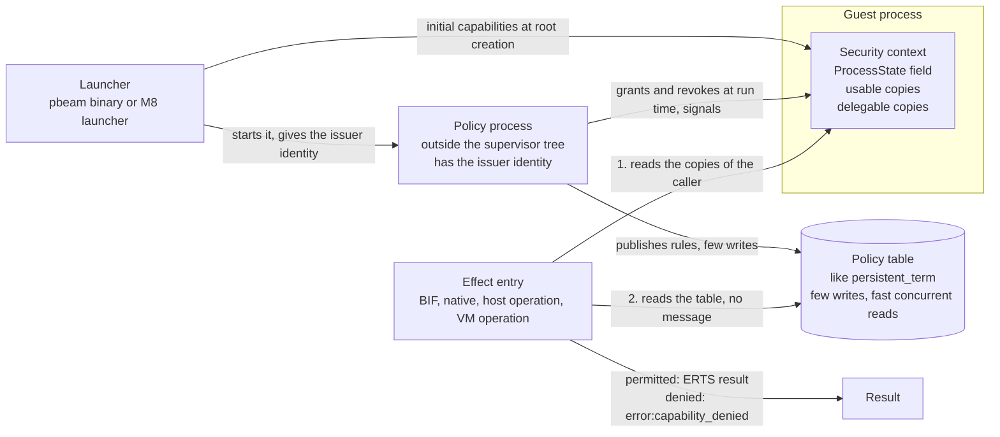
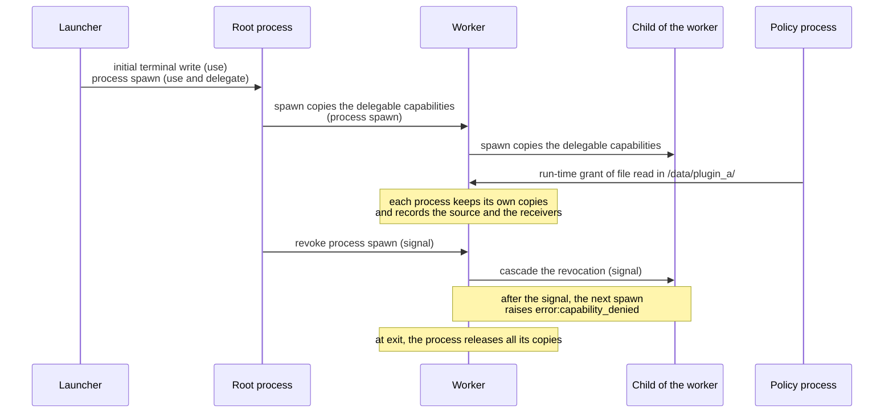

# Capability security migration and implementation

Status: proposed migration contract. No capability security mechanism is implemented by this document. Read the [security design](capability-security-design.md) and [runtime specification](portable-beam-spec.md) with this guide.

GitHub Issues and their native dependencies define task ownership, order, and status. This guide defines technical transition contracts and acceptance evidence. It is not a second task tracker.

## Baseline and sequence

Start implementation only after M2 acceptance. The owner decision of 2026-10-09 sets the milestone order: M4 Tooling and examples, M5 Interactive host I/O, M6 Capability security, M7 Linked native calls, M8 Embedded application, M9 Pinned Terra scenario, and M10 Multiple schedulers. This security work is M6. It runs in parallel with M5. Issues #7–#23 keep their numbers, and their titles use the new milestone tags. Record the order with native issue dependencies when the implementation tasks are approved.

The current toolchain pins OTP 29.1.1 in `mise.toml`. The discussion's OTP 28 example is not the implementation baseline. Recheck the pinned version before implementation. Capture M2's accepted command, output, errors, native entry paths, module set, and platform evidence as the migration baseline.

The current code is one `pbeam-runtime` crate. The specification's crate names describe logical responsibilities. Keep these responsibilities in modules until a current consumer requires a crate boundary. Do not create six provider interfaces or a security workspace in advance.

Preserve original OTP BEAM execution through `io`, `group`, `user_drv`, and `prim_tty`. Native dispatch belongs at the verified native entry, including `nif_start`. Do not replace `Elixir.IO`, `io:put_chars/2`, or a BEAM wrapper with direct Rust output. The current static `load_nif` model opens no native library file. It must remain distinct from a future dynamic native loading permission.

## Current code and required changes

| Current owner | Current role | Migration contract |
| --- | --- | --- |
| `src/runtime/process.rs` | Process execution state and group leader | Add the subject and security context to process ownership. |
| `src/runtime/scheduler.rs` | Processes, messaging, shared state, timers, and node resources | Authorize protected VM operations. Preserve identity during ownership changes. |
| `src/runtime/interpreter/native.rs` | Static NIF registration and dispatch | Add reviewed operation metadata and restrict the context available to adapters. |
| `src/runtime/interpreter/native/prim_tty.rs` | OTP argument conversion and terminal native bindings | Preserve OTP semantics for authorized calls. Send effects through the authorized boundary. |
| `src/runtime/host/` | Terminal operations, output, signals, clocks, and system information | Separate operation intent from authorized execution and provider selection. |
| `src/runtime/resources.rs` | Node data keyed by Rust `TypeId` | Retain this typed state store. It is not a capability resource table. |
| `src/runtime/tty.rs` | TTY records located through references | Add checked rights, holder, generation, and revocation without treating a reference as sufficient authority. |
| `src/runtime/regex_code.rs` and `src/runtime/pcre2.rs` | Compiled regular expressions and the C library interface | Review ownership, input cost, cleanup, and the native TCB. |

A reference can locate a runtime record without proving permission to use that record. The planned opaque resource handle must not be inferred from an integer, PID, or ordinary reference. Keep lookup identity, ownership, and authority separate.

## Transition 1: preserve behavior and expose the boundaries

First refactor the existing native and host path without changing its accepted behavior. Trace all callers before moving an operation. Keep OTP argument validation, result conversion, exception behavior, and side effects at their current verified boundaries.

List each executed BIF, native MFA, instruction fast path, VM operation, and host operation. For each entry, record authority requirements, determinism, execution class, observable effects, and cost. A pure declaration is reviewed metadata, not a proof about Rust or C code. The [effect inventory](effect-inventory.md) holds this list.

Include existing operations beyond terminal writes:

- Spawn, send, exit, links, monitors, aliases, group-leader changes, names, inspection, and global runtime information.
- ETS, persistent terms, shared resources, atoms, mailboxes, and retained binary storage.
- System and monotonic clocks, timer ordering, timezone and locale reads, and `uname` information.
- Terminal descriptors, mode changes, window size, termcap setup, output, and host signal dispositions.
- Regex compilation and execution, PCRE2 C code, linked terminal libraries, `libc`, and their dependencies.

A host signal disposition or locale change affects the OS process. It cannot be treated as an isolated process-local operation. Classify startup initialization separately from guest requests. Classify scheduler clock reads separately from guest-visible clock access. Moving an operation into a module called Host does not authorize it.

Acceptance: the M2 checks retain their exact results. The inventory names every existing effect entry and its execution owner. Unknown entries remain explicit and prevent secure-profile acceptance.

## Transition 2: process identity and authority

The subject is the process. The first deployment has one realm, and the process lifetime of the security context replaces a separate incarnation (see [Transition 2 decisions](#transition-2-decisions)). This does not establish tenant isolation.

The security context holds the usable and delegable capabilities of the process. A budget account comes with the first budget gate. Only the trusted launcher issues initial authority within host policy. A manifest requests authority; it does not issue authority. Guest terms cannot construct grants or choose an issuer.

Separate use from delegation. A parent can create a restricted worker only within its delegation ceiling. A use grant alone does not grant delegation. Child authority, lease, and budget cannot exceed the validated delegation template.

Attach the context to the process. Scheduler migration moves it with process ownership. Neither thread-local state nor a worker's current PID is an authority source. A restart is a new process. It gets only the capabilities that its spawner can delegate at that time, so it cannot recover authority that was revoked from its spawner.

Reserve child budgets from a shared parent account or reference that account. Never copy an independent full budget on spawn. Define resource ownership and quota failure behavior before enforcing each quota.

Acceptance: forged grants fail. Spawn cannot increase authority or duplicate a budget. Migration preserves the subject. Restart does not restore revoked grants. Trusted execution retains the accepted process behavior.

### Transition 2 decisions

Status: confirmed by the owner in the design review of [#310](https://github.com/fahchen/pbeam/issues/310). These decisions answer the "First grant" choices for transition 2. Transition 2 has no budget gate: the "First budget gate" choices wait in the [backlog](backlog.md). A later consumer that needs a different answer changes the decision in its own design task.

Transition 2 first adds a replaceable authorization foundation, and every effect entry calls it. A run with no policy skips each check (decision of [#368](https://github.com/fahchen/pbeam/issues/368)), and the `AllowAll` policy of the tests permits all operations, so both give the same results as the pinned ERTS. When a check permits an operation, the result must be identical to the pinned ERTS result. A denial is behavior that ERTS does not have, so security-specific negative tests are its oracle.

#### Granting and checking

Granting and checking are two separate steps. In a capability model, to hold a capability is the authority: a capability is a reference that a guest cannot forge, and it carries its own constraints. Thus the complex decision occurs at grant time, when the issuer selects the capability and its constraints. A check is a mechanical test of the capability that the caller holds.

| | Granting | Checking |
| --- | --- | --- |
| Question | Which process holds which capability, with which constraints? | Does a capability of the caller permit this use? |
| Time | Issue, delegation at spawn, and revocation. | Each effect, for example a file read, a terminal write, or a spawn. |
| Actor | The launcher (initial capabilities), the policy process (at run time), and a delegating process (it can only reduce). | The runtime, in the scheduling turn of the caller. |
| Speed | Not frequent. It can be slow and can run any policy code. | Frequent. It must be fast and sends no message. |
| Result | The security context of the process gets or loses a capability. | Permitted: the same result as ERTS. Denied: `error:capability_denied`. |

#### Capability kinds

One capability covers one kind of resource. A capability has a kind, a set of permitted operations, and constraints. A check passes when the caller holds a capability of the kind, the operation is in the permitted set, and the arguments are within the constraints.

| Capability | Operations | Constraint fields | Protected effect entries (examples) |
| --- | --- | --- | --- |
| `process` | `spawn`, `link`, `monitor`, `exit_other`, `send`, `inspect`, `group_leader` | `modules`: the modules that a child can start in, or `any`. Only `spawn` compares it. | `erlang:spawn/3`, `erlang:spawn_opt/4`, `erlang:link/1`, `erlang:monitor/2`, `erlang:exit/2`, the `send` instruction, `erlang:send/2`, `erlang:send/3`, `erlang:start_timer/3`, `erlang:process_info/2`, `erlang:is_process_alive/1`, `erts_internal:is_process_alive/2`, `erts_internal:group_leader/2`, `erts_internal:group_leader/3` |
| `terminal` | `write`, `read`, `raw_mode`, `window_size`, `setup`, `query` | None. | `prim_tty:write_nif/2`, `prim_tty:read_nif/3`, `prim_tty:tty_select/2`, `prim_tty:tty_init/2`, `prim_tty:tty_window_size/1`, `prim_tty:setupterm_nif/0`, `prim_tty:setlocale/1`, `prim_tty:isatty/1`, `prim_tty:tty_create/1` |
| `port` | `spawn`, `command`, `close`, `inspect` | `executables`: the permitted executable files. | `erlang:open_port/2`, `erlang:port_command/2`, `erlang:port_close/1`, `erlang:port_info/1` |
| `env` | `read`, `write` | `names`: the permitted variable names. | `os:getenv/1`, `os:putenv/2` |
| `signal` | `handle`, `ignore` | `signals`: the permitted host signals. | `os:set_signal/2` |
| `runtime` | `halt`, `system_flag`, `load_nif` | None. | `erlang:halt/2`, `erlang:system_flag/2`, `erlang:load_nif/2` |
| `persistent_term` | `read`, `write` | None. | `persistent_term:get/0`, `persistent_term:get/1`, `persistent_term:get/2`, `persistent_term:put/2` |
| `file` (later) | `read`, `write`, `list` | `root`: a handle of a granted directory. | File operations relative to a directory handle (`openat`). |

Decisions of #335 for the checks of this table. An entry checks after its argument checks and before its first effect, as the spawn check does. A constraint compares the name that the BIF gets: the program name of `open_port/2` as the caller gives it, with no path resolution, and the variable name of `os:getenv/1`, each as its native bytes in the file name encoding of the host. `erlang:port_command/2` and `erlang:port_close/1` compare the program name of the port. `os:set_signal/2` with `default` needs both `handle` and `ignore`, because the table names no operation for it and `SIG_DFL` can end the OS process. Suikou review 01a12608 added the `runtime` kind for the effects on the whole runtime ([#369](https://github.com/fahchen/pbeam/issues/369)). `erlang:halt/2` checks `halt` after the checks of the options and the status, also for `abort` and a crash dump slogan. `erlang:system_flag/2` checks `system_flag` for each item and value that the PBeam value check accepts, also `debug_flags`. A value that only the missing subsystem rejects, such as a scheduler count above the host count, raises `capability_denied` in a denied process where ERTS raises `badarg`. The `i_load_nif` path of `erlang:load_nif/2` checks `load_nif` after the path check and before the library state. A call of `erlang:load_nif/2` through `apply` only gives an error and loads nothing, so it has no check. The same review added the operation `send` to the `process` kind ([#370](https://github.com/fahchen/pbeam/issues/370)). The `send` instruction, `erlang:send/2`, and `erlang:send/3` share one send path, which checks `send` once, after the check of the destination form and before the name lookup. `erlang:start_timer/3` checks `send` after the checks of the time and the destination. `erlang:link/1` checks `link`, and `erlang:monitor/2,3` check `monitor` after the checks of the options, the type, and the target, also for the pid of the caller. `erlang:exit/2` checks `exit_other` for a signal to another process, also through its alias, and for a port. A signal to the caller, also through its alias, has no check. A check comes before the runtime error of a part that PBeam does not support, such as a port, so a denied process cannot stop the run with it. The same review added the `persistent_term` kind for the global persistent term store ([#371](https://github.com/fahchen/pbeam/issues/371)). ERTS checks no argument of `persistent_term:get/0,1,2` and `persistent_term:put/2`, so each checks first: `get/0,1,2` check `read`, also for a key with no value, and `put/2` checks `write`, also for a key that has the same value. The trap exports of `get/0` and `put/2` continue a permitted call, so they do not check again. The same review added the operations `setup` and `query` to the `terminal` kind and the operation `inspect` to the `port` kind ([#372](https://github.com/fahchen/pbeam/issues/372)). `setup` and `query` stay separate operations. `prim_tty:setupterm_nif/0` and `prim_tty:setlocale/1` check `setup`. ERTS reads no argument of them on Unix, so each checks first. `prim_tty:isatty/1` and `prim_tty:tty_create/1` check `query` after the fd check. `erlang:port_info/1` checks `inspect` for the program name of an open port, as `erlang:port_command/2` and `erlang:port_close/1` do, also for a port of another process. A closed port and an atom give `undefined` with no check, because they have no program name. The same review added the operations `inspect` and `group_leader` to the `process` kind ([#373](https://github.com/fahchen/pbeam/issues/373)). `erlang:process_info/2`, `erlang:is_process_alive/1`, and `erts_internal:is_process_alive/2` check `inspect`, and `erts_internal:group_leader/2,3` check `group_leader`, each only when the target is another process. A call for the caller has no check. Each checks after its argument checks and before the process lookup, so a denied call does not tell whether a process has the pid, and a denied request sends no signal and no reply. `erlang:group_leader/2` in `erlang.beam` calls `erts_internal:group_leader/2`, and `erts_internal:group_leader/3` when the target has incoming signals, so it checks through them. `erlang:is_process_alive/1` traps to `erts_internal:is_process_alive/1` for a process that exits or has incoming signals, and that Erlang function calls `erts_internal:is_process_alive/2`, so the trap path checks again. The column "Capability" of the [effect inventory](effect-inventory.md) gives the state of each entry.

Decisions of [#368](https://github.com/fahchen/pbeam/issues/368) (Suikou review 01a12608). The inventory value `ambient` marks an entry that has no check by decision: each process can call it, also a process with no capability, and a policy cannot deny it. Each `ambient` row gives its reason, and the inventory test accepts `ambient` only with a reason. These entries are `ambient`: `erlang:unlink/1` and `erlang:demonitor/1,2`, which change only a link or a monitor of the caller; `erlang:register/2`, `erlang:unregister/1`, and `erlang:whereis/1`, because a send or a monitor by name checks the `process` capability; each `ets` BIF, because the access mode of the table controls the access; `erlang:monotonic_time/1` and `os:system_time/1`, because a clock is a source of nondeterminism, not an authority; `erlang:universaltime_to_localtime/1`, `erlang:system_info/1`, `erlang:node/0,1`, and `erlang:function_exported/3`, which only read; and `erlang:list_to_atom/1` and `re:compile/2`, whose resource use is a budget, not a capability. The backlog has the `name`, `ets`, and `clock` kinds, a target constraint of `process` `send`, and the check of `erlang:list_to_pid/1`.

The value `ambient` of one entry is different from the start option that skips all checks. A run with no policy skips each check, as if each entry were `ambient`: `BeamProgram::execute`, and the `pbeam` binary without `--policy` or with `--no-capability-checks`. The launcher sets the option before the root process starts: `Scheduler::without_checks` keeps one `bool`, each check reads it first, and no BIF can change it. With the option, no process gets a capability copy, the `{capabilities, Map}` spawn option raises `badarg` for a `Map` that is not valid but does not reduce the child, and `pbeam_cap:revoke/2` and `pbeam_cap:request/2` return `ok` with no effect. The binary rejects `--no-capability-checks` with `--policy`, because the policy would then have no effect. A run with a policy module or a Rust policy makes each check, and `AllowAll` stays for the tests of the checks. Measured cost: a loop of 1,000,000 `Self ! x` and `receive` uses a median of 1.920 s CPU time with the option and 1.935 s with `AllowAll` (40 runs each), less than 1% difference.

A capability is a runtime value, not a term. BEAM code cannot construct one: `{grant, file_read, "/"}` is only a tuple, and no BIF makes a capability from a term. The runtime keeps these fields:

```text
Capability {
  id:          unique in the run, never given again
  kind:        process | terminal | port | env | signal | runtime | persistent_term
  ops:         the set of permitted operations
  constraints: the constraint fields of the kind
  delegable:   true when the holder can give it to a child
  source:      launcher | policy | process(parent)
}
```

Task #334 adds `kind`, `ops`, `constraints`, and `delegable`. Revocation is the first consumer of `id` and `source`, so #336 adds them: each copy in a security context has its `id`, and the delegation record of the copy keeps its `source`, because the record can live longer than the copy (see [Revocation](#revocation)). The source is the launcher, the copy of the parent, or the policy for a run-time grant of #337. The issuer interface of #334 is the Rust trait `Policy` with one function, `initial`, which returns the capabilities of the root process. The `AllowAll` policy gives a delegable capability of each kind with all operations and the constraint `any`; the tests use it. A Rust host gives a policy to `BeamProgram::execute_with_policy`. #337 adds the policy module in BEAM code, with the requester argument of `initial/1` and `grant/3` (see [Policy module, policy process, and policy table](#policy-module-policy-process-and-policy-table)).

#### Subject, security context, and lifetime

The subject is the process. The security context is one new `ProcessState` field (`src/runtime/process.rs`). It holds the copies of the capabilities of the process: the capabilities that the process can use and the capabilities that it can delegate. The context moves with the process when the multiple-scheduler work (M10) moves process ownership between threads. Thread-local state and the current pid of a worker are not authority sources.

The capabilities live as long as the process. When a process exits, the runtime releases all its copies. No check finds a capability by the pid number, so a process that gets a pid number again cannot get the capabilities of an old process. The delegation records of a copy (its source and its receivers) hold pids. PBeam never gives a pid number again: `Scheduler::next_pid` (`src/runtime/scheduler.rs`) takes each pid from a `u64` counter (row "Process and reference counters" of [ERTS differences](erts-differences.md)). Thus a record cannot name a later process, and transition 2 has no incarnation field. If PBeam uses process table slots again as ERTS does, the delegation records need an incarnation (see the backlog). A run has one isolation domain, so transition 2 has no realm. A realm comes with its first consumer, for example a host that runs plugins that do not trust each other, each with its own policy (see the backlog).

This decision replaces the realm, process, and incarnation identity that an earlier version of this contract asked for. No transition 2 consumer reads a realm or an incarnation, and the process lifetime of the context gives the same guarantee.

#### Issuers

The launcher issues the initial capabilities when it makes the root process: it calls `initial/1` of the policy module. The launcher also starts the policy process and gives it the issuer identity. At run time, the policy process issues capabilities with `grant/3` and revokes them. Only the policy process can call the issue interface. A guest process cannot call it.

Example: a launcher runs a third-party plugin `Plugin.main/0`. The root gets `terminal` with `write` (use only) and `process` with `spawn` (use and delegate). A worker of the plugin requests a `file` capability to read `/data/plugin_a/config.json`. The policy finds the path in the permitted area and grants `file` with `read`, constrained to that directory. Later the plugin behaves incorrectly, and the policy process revokes that capability. The next file read of the worker raises `error:capability_denied`.

#### Inheritance and delegation

A child gets the delegable capabilities of its parent, as capabilities that it can use and delegate. A capability that the parent can only use does not go to the child. When the launcher gives the root a delegable `process` capability with `spawn`, `link`, and `monitor`, an OTP supervisor tree works with no change.

The `spawn_opt` option `{capabilities, ...}` gives the child a part of the delegable capabilities of the parent. It can only reduce operations and constraints. A request for more operations or wider constraints than the parent can delegate raises `error:capability_denied`, and no process is made. Delegation from a process that is not the parent, for example a broker, waits in the backlog. The policy process can grant a capability at run time, so this need is smaller.

`erlang:spawn/3`, `erlang:spawn_link/3`, and `erlang:spawn_opt/4` make each process through `Scheduler::spawn` (`src/runtime/scheduler.rs`), and that function has one caller (`src/runtime/interpreter.rs:1872`). Thus the first check, `process` with `spawn` in `Scheduler::spawn`, covers each spawn BIF. `Scheduler::spawn` also makes the link of `spawn_link` and the `link` option, and the monitor of the `monitor` option. Thus a spawn with a link also checks `process` with `link`, and a spawn with a monitor also checks `process` with `monitor`, before the spawn takes a pid. A spawn cannot make a link or a monitor that `erlang:link/1` or `erlang:monitor/2` would deny. The `modules` constraint is not yet complete for OTP process starts: `proc_lib:spawn_opt/4` spawns `proc_lib:init_p/5` and gives the application MFA as an argument (`lib/stdlib/src/proc_lib.erl:269`), so a check of the spawn module finds `proc_lib`. A permission for `proc_lib` alone permits each MFA through this wrapper. Decision of #334: the constraint compares only the module of the MFA that the spawn BIF gets, and it does not look into the arguments of a start wrapper. Thus `proc_lib` starts are checked as `proc_lib`, and a fun that `erlang:spawn/1` starts is checked as `erlang`, because `erlang:spawn/1` spawns `erlang:apply/2` (`erts/preloaded/src/erlang.erl:10601-10602` at `OTP-29.1.1`). A rule for the own modules of a guest (#338) lists the start wrappers that it permits, for example `proc_lib` and `erlang`. The alternative, a check of the MFA in the wrapper arguments, needs the argument layout of each wrapper: `proc_lib:init_p/3` and `init_p/5`, then `gen:init_it/6` and the callback module of `supervisor`. That layout is internal OTP code, which changes between OTP releases, and a wrapper can start code through more levels than one. The module check does not limit authority: the child gets at most the delegable capabilities of its parent, and the parent can call each loaded module in its own process. An OTP supervisor restart is also a spawn by the supervisor process. The supervisor applies the start MFA of the child (`lib/stdlib/src/supervisor.erl:1034-1036` at `OTP-29.1.1`), and `proc_lib:start_link/5` calls `erlang:spawn_opt/4` with `link` and `monitor` (`lib/stdlib/src/proc_lib.erl:266-269`, `511-514`). A restarted child is a new process. It gets only the capabilities that the supervisor can delegate at the restart. Thus a restart cannot recover a capability that a revoker took from the supervisor or from a process above it, because the revocation removes the copy of the supervisor. A revocation of only the copy of the child does not remove the copy of the supervisor, so a restarted child gets that capability again. To take a capability from each later child too, the revoker revokes it at the supervisor. A capability that the policy granted to the old child at run time does not go to the new child; the new child requests it again.

#### Revocation

Each copy of a capability records its source and the child processes that got a copy of it. The policy process, the launcher, and the delegating process can revoke a capability. A delegating process can revoke only a capability that it gave. Another revoker gets `error:capability_denied`.

A revocation is a signal through the signal queue of [#221](https://github.com/fahchen/pbeam/issues/221). When the holder handles the signal, it deletes its copy and sends the revocation to each downstream process. As with the other control signals of ERTS, a revocation takes effect when the target handles the signal, not when the revoker sends it. A revocation does not end the holder. It does not close the resources that the holder already opened: transition 5 owns resource recovery. The cost of a revocation increases with the number of holders, and with multiple schedulers the signal goes between threads as other signals do. In return, a check finds the capabilities of the caller in its own copies, not in a run-wide capability table.

The exit of a holder must not stop a cascade. When a holder exits, it releases its copies, but the receivers of those copies can live longer. A later revocation from a process above the holder must still reach each downstream copy. Decision of #336: the delegation records are one tree of the run, keyed by the copy `id`, as the registered names are one table of the run. The record of a copy holds its holder, its source, and the copies that went from it to children. When a holder leaves the process table, it releases its copies: a copy with no receivers loses its record, and a copy with receivers keeps a released record. When the last receiver of a released record goes, the record goes too. A revocation that reaches a released record does not wait for a signal: the process that handles the revocation goes through the released record at once and sends the revocation signals to the live copies below it. Thus a revocation goes through each holder that exited, also when its source exited first or is the launcher. A check does not read the tree: it reads only the copies of the caller. The alternative, a hand-off of the receivers of an exiting holder to the source of each copy, needs a process to forward each hand-off when the source exits first, and the launcher is not a process. With multiple schedulers (M10), a spawn, an exit, and a revocation write this tree, so it needs a lock or a per-scheduler part.

The revokers of #336 are the launcher and the delegating process. The launcher is the Rust host: before each scheduling step, it revokes the initial copies of the root process of each kind that `Policy::revocations` gives. A delegating process calls `pbeam_cap:revoke(Pid, Kind)`: it revokes the copies of `Kind` that the caller gave to `Pid` at spawn and returns `ok`. The authority of the caller is in its own delegation records: when the caller gave `Pid` no copy of `Kind` that still has a record, the call raises `error:capability_denied`. Thus a revocation of a child whose copy and records went at its exit also raises `error:capability_denied`. The revocation of the policy process waits in the [backlog](backlog.md) for its first consumer.

Transition 2 has no lease. A lease waits in the backlog.

#### Denial result

A denied operation raises `error:capability_denied` before it has an effect. For example, a denied spawn raises it before it takes a pid. The reason names no capability and no policy. ERTS has no authorization policy, so this result is PBeam-specific. The task that adds the first check records it in [ERTS differences](erts-differences.md).

#### Policy module, policy process, and policy table

A policy is a BEAM module in any BEAM language, for example Elixir or Erlang. It has two callbacks:

```elixir
defmodule PBeam.Policy do
  @type kind :: :process | :terminal | :port | :env | :signal
  @type requester :: %{pid: pid(), parent: pid() | :none, initial_call: mfa()}

  # At run start: the initial capabilities of the root process.
  @callback initial(requester()) :: [PBeam.Capability.t()]

  # At run time: a process requests a capability of a kind.
  @callback grant(kind(), request :: map(), requester()) :: {:grant, PBeam.Capability.t()} | :deny
end
```

The launcher loads the policy module and starts a trusted policy process before the root process. The policy process is outside the supervisor tree, so a supervisor shutdown does not end it. The application must not end or replace it. Because a guest with `process` `exit_other` can send an exit signal to any pid, #337 defines how the runtime protects the policy process, for example an `exit_other` constraint that excludes trusted processes. The policy code runs at grant time only. A return value that is not a grant form, an exception, or a reduction limit overrun is a denial.

The policy process publishes data to a shared policy table, like `persistent_term`. Writes are not frequent and can be slow. A write replaces the table, and the old table is freed when it has no reader, as the `persistent_term` table pointer and its update after thread progress do (`erts/emulator/beam/erl_bif_persistent.c:187`, `773-779` at `OTP-29.1.1`). Reads take no lock, so multiple schedulers can read at the same time. A check reads the capabilities of the caller and the table directly. It sends no message and runs no policy code.

The effects of the policy process are checked against the capabilities that the launcher gave it, not against the rules that it publishes. When the policy process stops, the published table stays valid, and a new run-time grant request is denied. The policy process task decides whether the launcher restarts the policy process and whether `erlang:processes/0` shows it.

Decisions of #337 for the policy module and the policy process:

- The launcher input is a loaded module name: `BeamProgram::execute_with_policy_module(Module, Function, Arguments, Policy)` and the option `--policy Policy` of the `pbeam` binary. The run checks that `Policy` exports `initial/1` and `grant/3` before it makes a process. Without a policy module, the Rust `Policy` of `BeamProgram::execute_with_policy` stays the issuer. `BeamProgram::execute` and the binary without `--policy` have no policy, so they skip each check (#368).
- A capability is a map in the policy code, in the form of the `{capabilities, Map}` option: `#{kind => Kind, operations => [Operation], delegable => Boolean, Field => any | [Name]}`. Each key is required, and `Field` is the constraint field of the kind; a kind with no constraint field has no `Field`. A map with a missing or another key is not a grant form. The runtime makes a capability only from the value of a call of the policy process, so guest code still cannot make one.
- `initial/1` returns a list of such maps. Each other value, an exception, a reduction limit overrun, and an exit of the policy process during the call stop the run with the error `the policy denied the root process: <cause>`, because no guest code ran yet and a run with no root capabilities hides the cause. `grant/3` returns `{grant, Capability}` or `deny`. Each other value, an exception, and an overrun deny the request.
- The request is `pbeam_cap:request(Kind, Request)`. `Kind` is a kind atom; `Request` is any term that the policy code examines. The call adds the request to the queue of the policy process and waits. The policy process sends a grant signal to the requester, which adds the copy with the source `policy` when it handles the signal, so a later check of the requester finds the copy. The call then returns `ok` or raises `error:capability_denied`. A run with no live policy process, and a call of the policy process itself, raise `error:capability_denied` at once.
- The policy process runs one call at a time, in the order of the requests, and keeps its process state between the calls, for example its dictionary. The reduction limit of one call is 100000 reductions, 25 turns of `CONTEXT_REDS`, and the policy process checks it at the end of each of its turns: a switch out for the budget, a wait in `receive`, a return, and an exception. Thus a call that waits often cannot pass the limit. ERTS has no such limit. A call that waits for a message has no time limit.
- The launcher makes the root process with `<0.0.0>` and the policy process with `<0.1.0>`. The policy process has no parent and no link. The launcher gives it the capabilities of `AllowAll`, so the effects of the policy code are permitted with no other check.
- Protection: no implemented BIF gives the pid of the policy process to a guest. A request goes through the BIF, and the answer is a signal of the runtime. `erlang:processes/0`, `erlang:list_to_pid/1`, and `erlang:binary_to_term/1` are not implemented. The task that implements one of them must keep the policy process out of its result or check `process` `exit_other` for trusted processes. The alternatives were an `exit_other` constraint that excludes trusted processes, which needs the `exit_other` check of #335 first, and a policy process that ignores exit signals, which ERTS has for no process.
- The launcher does not start the policy process again. After its exit, each request is denied, and the requests that wait get a denial.
- The shared policy table waits in the [backlog](backlog.md) for its first consumer, a check that reads it. Until then, a check reads only the copies of the caller.

An opt-in extension can ask the policy at check time. A capability can have a mark that makes its check call the policy BEAM code, which returns `allow` or `deny`. Only a capability with this mark sends a message at check time. The default is off. Transition 2 has no scope syntax: the policy code examines the operation name and the arguments, and the runtime needs only the operation and a summary of the arguments.

A run with the default trusted configuration needs no new API, and its behavior is the same as on ERTS. In a restricted run, BEAM code calls the PBeam-specific module `pbeam_cap` to request and revoke a capability, and uses the `spawn_opt` option `{capabilities, Map}`. #336 adds `pbeam_cap:revoke/2`, and #337 adds the request. #334 adds this option: `Map` maps a kind atom to a map with the optional keys `operations`, `delegable`, and the constraint field of the kind, and an omitted key keeps the value of the parent copy (row "Capability checks" of [ERTS differences](erts-differences.md)). ERTS does not have these interfaces. The task that adds each interface records it in [ERTS differences](erts-differences.md).

#### Granting procedure

The names in this procedure are examples.

```text
# 1. Run start: the launcher issues the initial capabilities.
start_run(policy_module):
    policy_proc = spawn_trusted(PolicyProcess, policy_module)   # outside the supervisor tree
    root = new_process(entry)
    root.caps = policy_module.initial(requester(root))           # each source = launcher
    run(root)

# 2. A parent makes a child: inherit by default, reduce on request.
spawn(parent, {M, F, A}, opts):
    check(parent, process, spawn, %{module: M})                  # check: can the parent spawn M?
    if link in opts: check(parent, process, link)                # spawn_link and the link option
    if monitor in opts: check(parent, process, monitor)          # the monitor option
    requested = opts[:capabilities]                              # optional: a part for the child
    if requested != nil:
        for kind in keys(requested):
            if no cap in parent.caps where cap.delegable and cap.kind == kind:
                raise error:capability_denied                                # kind not delegable
    child_caps = []
    for cap in parent.caps where cap.delegable:
        if requested == nil:
            child_caps += copy(cap, source: {process, parent.pid})          # inherit as is
        else if r = requested[cap.kind]:
            if r.ops ⊆ cap.ops and r.constraints ⊆ cap.constraints:          # reduce only
                child_caps += copy(cap, ops: r.ops, constraints: r.constraints,
                                   delegable: r.delegable ?? cap.delegable,
                                   source: {process, parent.pid})
            else:
                raise error:capability_denied                                # widen: denied
    child = new_process({M, F, A}, caps: child_caps)
    records[cap.id].receivers += child_cap.id for each copied cap          # for revocation
    return child.pid

# 3. Run time: a process requests a new capability from the policy.
request(caller, kind, request):                                  # example: read /data/plugin_a
    reply = call(policy_proc, {grant, kind, request, requester(caller)})
    case policy_module.grant(kind, request, requester(caller)):  # runs in the policy process
        {grant, cap} -> send_signal(caller, {add_cap, cap with source: policy})
        deny         -> raise error:capability_denied

# 4. Revocation: an issuer or the delegating process.
launcher_revoke(kind):                                           # Policy::revocations
    for cap in root.caps where cap.kind == kind: revocation(cap.id)

revoke(revoker, holder, kind):                                   # pbeam_cap:revoke(Pid, Kind)
    copies = [r for cap in revoker.caps where cap.kind == kind
                for r in records[cap.id].receivers
                if records[r].holder == holder]                   # a delegator revokes only its own
    if copies == []: raise error:capability_denied
    for copy in copies: revocation(copy)                          # the policy process: #337

revocation(cap_id):
    if records[cap_id].released: cascade(cap_id)                  # the holder exited
    else: send_signal(records[cap_id].holder, {revoke, cap_id})

on_signal(holder, {revoke, cap_id}):                             # when the holder handles it
    delete holder.caps[cap_id]
    cascade(cap_id)

cascade(cap_id):                                                 # also at the exit of the holder
    for child_cap_id in remove(records[cap_id]).receivers:
        revocation(child_cap_id)                                 # through released records

# 5. Process exit: release all capabilities.
on_exit(process):
    release each copy: drop its record, or keep it while it has receivers
    drop process.caps
```

#### Components and the check flow



#### Inheritance, delegation, and revocation



#### Implementation tasks

The implementation tasks of [m6-e1] are in this order:

1. [#334](https://github.com/fahchen/pbeam/issues/334) Add capability types and the policy interface, checked at spawn. It adds the capability kinds, the security context field, the replaceable policy interface with an allow-all default, inheritance, the `{capabilities, ...}` reduction, and the `process` `spawn` check in `Scheduler::spawn`. Negative tests use a Rust test policy that denies one operation. Blocked by this design.
2. [#335](https://github.com/fahchen/pbeam/issues/335) Check every effect entry against its capability. Batches by effect inventory class. The inventory test fails when an effect entry has no check. Blocked by #334.
3. [#336](https://github.com/fahchen/pbeam/issues/336) Record delegation and revoke capabilities with signals. Blocked by #334, and parallel with #335.
4. [#337](https://github.com/fahchen/pbeam/issues/337) Run a policy module, a policy process, and a shared policy table. A policy in Elixir and a policy in Erlang both work. Blocked by #334 and #336. It adds the policy module, the policy process, `initial/1`, `grant/3`, and `pbeam_cap:request/2`. The shared policy table and the revocation of the policy process wait in the backlog for their first consumer.
5. [#338](https://github.com/fahchen/pbeam/issues/338) Add the first audit rules with an Elixir policy, for example "a guest can only write to the terminal and spawn its own modules", with negative tests and an ERTS comparison of the permitted part. Blocked by #335 and #337.

With the default policy, each task keeps every existing pinned-ERTS comparison result.

## Transition 3: authorized terminal effects and providers

The first provider contract covers the accepted terminal path. Define text output separately from input, TUI control, and raw mode. Grant only the operations required by the accepted scenario. Ordinary untrusted text must not gain terminal control through escape sequences.

An operation intent contains the requested operation and parameters. The authorization engine checks the actual resource, subject, grant, policy, and budget before it creates an authorized request. The provider execution entry accepts only that runtime-created request. Guest deserialization must not create it.

Trusted host configuration selects the provider. A grant defines authority; it does not let the guest replace the provider. Provider replacement must preserve the supported operation and security contract. An unsupported provider fails closed.

Use a native terminal provider and a memory provider to verify replacement through the same authorization path. A memory provider is a test backend, not a reason to bypass policy. Trusted application and secure guest profiles share the gate. A trusted profile can have explicit broad grants, but does not establish a sandbox guarantee.

Terminal setup and restoration can require limited runtime service authority. Document that authority separately from guest text authority. Cleanup must restore terminal state on exit, error, and cancellation. It must not require authority from an exited guest or perform extra business operations.

Acceptance: a denied request invokes neither provider. A granted operation gives the defined provider result. Native output retains the M2 contract. Text access does not permit raw mode or control output. Failure and cancellation restore terminal state.

## Transition 4: protect the OTP service path

A low-authority process can send a request to a higher-authority IO service. Checking only the service process at the terminal leaf would permit an authorization bypass.

Authenticate the requesting subject at the reviewed protected entry. Create a request grant bound to the target service, operation, validated parameters, budget, and lifetime. The broker uses this grant within its service ceiling. It does not automatically use its full authority for guest work.

Keep trusted per-request records outside ordinary guest message terms. Trace the real pinned OTP `io` → `group` → `user_drv` → `prim_tty` path. Each reviewed forwarding step must preserve the authenticated request relation and limit any derived operation. Define how encoding, batching, and delayed writes relate to the original request before implementation.

Do not infer the caller from a PID supplied in an IO request. Do not use one global or thread-local caller context for a service that can process several requests. Do not make every ordinary send carry ambient authority. Generic `GenServer.call` does not establish business authorization.

Preserve the pinned OTP BEAM modules. Select a runtime service adapter or a reviewed explicit broker adapter only after the forwarding trace identifies the required boundaries. If the supported protocol cannot retain authenticated authority, reject that secure entry until an adapter contract exists.

Direct protocol messages must fail authorization or pass an equivalent authenticated check. Unadapted privileged services remain unavailable to secure guests. Same-realm membership alone is insufficient authorization.

Acceptance: forged caller PIDs, request terms, correlation references, and direct legacy messages cannot trigger privileged output. Concurrent requests keep separate identities. A low-authority caller cannot borrow a broker's wider authority.

## Transition 5: resource lifecycle and revocation

Retain internal resource records. Add opaque handles whose authority binds the resource key, holder, realm, rights, and grant. A slot plus generation, or an equivalent identity scheme, prevents stale lookup after resource reuse. Decide the concrete representation before implementing the first handle.

Check kind, generation, holder, realm, rights, lease, and revocation on every use. Open-time authorization is insufficient. An `Arc` clone or mailbox copy must not delegate authority.

Provide explicit delegation that binds the receiver and can only reduce rights and lifetime. Fix the secure-profile rule for forbidden transfer before implementation. Rejecting the send is the proposed rule. Resolve compatibility and the exact error contract with the pinned ERTS tests and security-specific tests.

Define close, process exit, cancellation, pending operations, and resource ownership together. Cleanup releases or restores resources. It cannot silently issue new privileged application effects. Persisted or cross-VM handle data cannot restore live authority.

Acceptance: forged integers, copied references, stale generations, wrong holders, excess rights, and revoked grants fail. Exit and cancellation release owned resources. Reuse cannot make an old handle valid again.

## Transition 6: asynchronous dispatch

Implement this contract when the first queued operation needs it. Do not create an unused executor framework.

Before enqueue, fix the subject, incarnation, operation, resource, and parameters. Validate authority and atomically reserve the shared budget. The authorized request records its request identity and grant or policy generation.

Define one dispatch decision that orders authorization against revocation. Revocation completed before this decision prevents execution. Recheck queued leases and grants at this point. Revocation after approved dispatch prevents later use and attempts cancellation; it cannot undo a write or a remote operation.

Completion routing checks request identity and process incarnation. A dead or replaced process receives no stale result. Settle actual cost and release the reservation even when guest delivery is discarded. Define ownership of a resource returned after cancellation so it cannot leak.

Acceptance: concurrent reserves cannot overspend. Queued revoked requests never reach the provider. Late completion cannot resume a new incarnation or resume a call twice. Dispatch and cancellation races leave no reservation or resource leak.

## Secure-profile acceptance

Keep secure guest execution unavailable until the supported inventory has complete authorization, bypass tests, and resource-bound evidence. Do not publish a general sandbox claim from one passing terminal test.

Bound hostile bundle decoding, literal expansion, atom creation, retained memory, mailboxes, process counts, in-flight work, and native input or output cost. Define secure-profile admission and quota failures separately from ordinary ERTS behavior. Do not add silent limits or shortcuts to the trusted compatibility path. An unimplemented operation gives a clear runtime failure and an entry in [ERTS differences](erts-differences.md).

In-process Rust and C extensions remain part of the TCB. A controlled `NativeContext`, static linking, safe Rust, and required-capability metadata do not prevent direct OS access. Review transitive dependencies, features, build scripts, and procedural macros. Build-time execution requires its own controlled environment.

Use security-specific negative tests as the authorization oracle. Use the pinned ERTS for granted-operation compatibility. Capture exact source locations and results for any instruction, BIF, term, or OTP protocol decision. Run `mise run lint` and `mise run check` for this documentation change. Implementation PRs retain the shared check and coverage gates.

## Later consumers and constraints

Carry these contracts into the M3, M5, and M7–M10 work. Read the current issues before editing their scope. The links below identify downstream integration points, not completed issue updates.

- M3 [#7–#9](https://github.com/fahchen/pbeam/issues/7) cover fairness, mailbox behavior, and exit. Preserve subjects, delegated spawn authority, shared budgets, and protected IPC.
- M5 [#19–#20](https://github.com/fahchen/pbeam/issues/19) cover suspension, cancellation, and late completion. Transition 6 follows these tasks and adds dispatch ordering, incarnation checks, cancellation cleanup, and budget settlement.
- M7 [#12–#14](https://github.com/fahchen/pbeam/issues/12) cover linked native registration, declarations, and SHA. Classify native entries, reserve protected MFAs, and retain the native TCB boundary.
- M8 [#15–#18](https://github.com/fahchen/pbeam/issues/15) cover bundles, manual launchers, Mix collection, and generated launchers. Treat manifests as requests and record launcher policy, profile, and code or native build identity.
- M9 [#21–#23](https://github.com/fahchen/pbeam/issues/21) cover Terra discovery, compatibility gaps, and release acceptance. Grant the terminal operations that the scenario uses and verify cleanup and protected IO forwarding.
- M10 [#10–#11](https://github.com/fahchen/pbeam/issues/10) cover cross-thread process ownership and work stealing. Move the security context with the process. Preserve exclusive execution and account for retained shared storage without using `Arc` sharing as authorization.

The existing downstream task range is [#7](https://github.com/fahchen/pbeam/issues/7) through [#23](https://github.com/fahchen/pbeam/issues/23). GitHub issue bodies and dependencies remain the source of their exact scope and order.

Add filesystem, network, environment, subprocess, and semantic service capabilities when a current consumer requires them. A permission taxonomy does not require unused provider implementations.

For filesystem access, use authorized directory-relative operations. Define symlink, mount, device, hardlink, and platform behavior. String normalization or canonicalize-then-open alone does not close path races. Test read, create, rename, and delete separately. Return unsupported when the platform cannot meet the claimed constraint.

For network access, distinguish raw connections from HTTP operations. Check resolved addresses and actual connection targets, each redirect, proxy routes, pooled connections, and IPv4 or IPv6 policy. Review transport-internal DNS, certificate files, environment reads, and background connections. A permission check around a client call does not constrain every internal effect.

Subprocess executable and argument restrictions do not contain the program's syscalls, hooks, scripts, or children. Secure subprocess support needs an independently enforced execution boundary. Do not grant shell strings as a constrained execution interface.

Audit, record/replay, controlled simulation, and isolated workers are later consumers. Audit defaults exclude secret bodies. Full record requires explicit retention and access rules. Replay must replace real effects and fail on missing or mismatched events. Complete replay also requires scheduler, timer, random, native, and input ordering. It is not established by a host log alone. No exactly-once external effect guarantee is implied.

## Choices required before each implementation

Resolve each choice in its consuming issue and design change. Do not encode an assumed answer as a placeholder implementation.

| Consumer | Required decision |
| --- | --- |
| First grant | Scope syntax, subset rules, issuer model, lease clock, and revocation representation. Transition 2: see [Transition 2 decisions](#transition-2-decisions). |
| First protected IO request | Entry list, trusted correlation storage, forwarding and batching rules, denial results, and service authority. |
| First resource handle | Opaque representation, generation reuse, transfer rules, ownership, and error mapping. |
| First budget gate | Quota unit, reservation ownership, excess behavior, and shared allocation accounting. Transition 2 has no budget gate: see [Transition 2 decisions](#transition-2-decisions) and the [backlog](backlog.md). |
| First queued operation | Dispatch linearization, policy changes, cancellation, cost settlement, and completion cleanup. |
| First constrained filesystem or network provider | Supported platform, enforceable semantics, dependency configuration, and real bypass tests. |
| First isolated extension | OS process, WASM, or another boundary and its tested guarantees. |
| First replay consumer | Event format, code identity, scheduler control, sensitive data policy, and mismatch behavior. |
